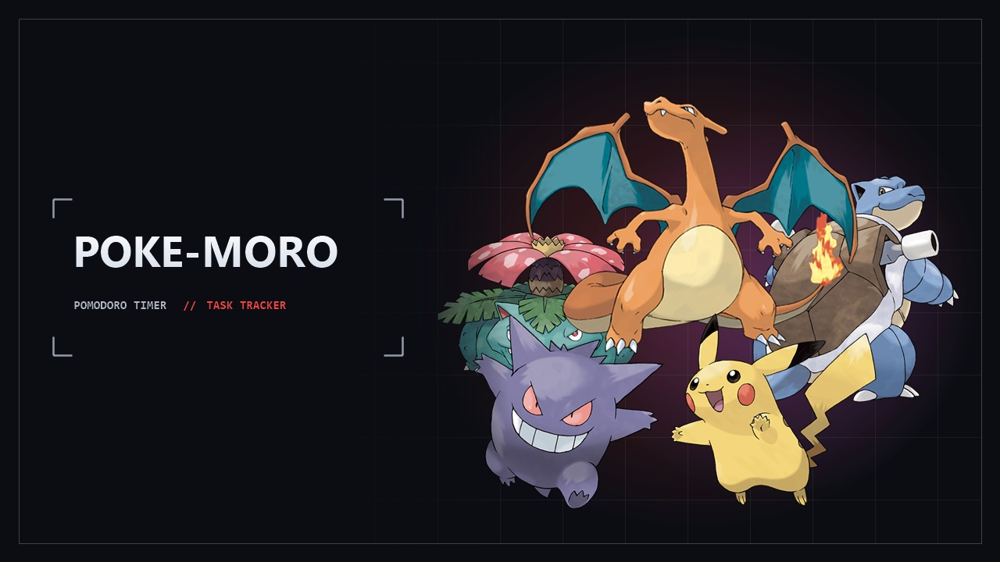

# Poke-moro — Anime Pokémon Pomodoro Timer (Pure Python + Flet)



Gamified Pomodoro productivity timer built **100% in Pure Python** using **Flet** and **HTTPX** (`PokéAPI v2`). Choose any of the 1,025 Pokémon as your focus partner, train together in 25-minute Pomodoro sessions, rest at the Pokémon Center, and watch your companion evolve automatically across focus cycles — with zero screen flickering.

## Key Features

- **Pomodoro Core (`25:00` / `05:00` / `15:00`):**
  - **Focus Mode (25m):** Energetic theme colored dynamically after your partner Pokémon's primary type (`FIRE`, `ELECTRIC`, `WATER`, `GRASS`, `GHOST`, etc.).
  - **PokéCenter Short Break (5m) & Long Rest (15m):** Smoothly transitions the card and background into a soothing Pokémon Center recovery theme.
  - **4-Pokéball Cycle Tracker:** Visual Pokéball indicators fill up as you complete each focus session, triggering a 15-minute Long Rest every 4 cycles.
  - **Auto-Evolution Mode:** Completing a focus session with *Auto-Evolve* enabled automatically evolves your partner Pokémon to the next form in its official PokéAPI evolution chain (e.g., `Charmander -> Charmeleon -> Charizard`).
- **Zero-Flicker Reactive Architecture:**
  - All controls (`Container`, `ProgressRing`, `Image`, `Text`) are instantiated once on startup.
  - The 1-second timer coroutine updates **only** `txt_timer.value` and `timer_ring.value` in-place without touching or blinking the Pokémon artwork.
  - `httpx.AsyncClient` caches visited Pokémon in memory (`POKEMON_CACHE`) and preloads adjacent `#id - 1` and `#id + 1` partners in the background.

## Running Locally

```bash
git clone https://github.com/hizzui/Poke-moro.git
cd Poke-moro
pip install flet fastapi==0.112.2 httpx
python main.py
```
